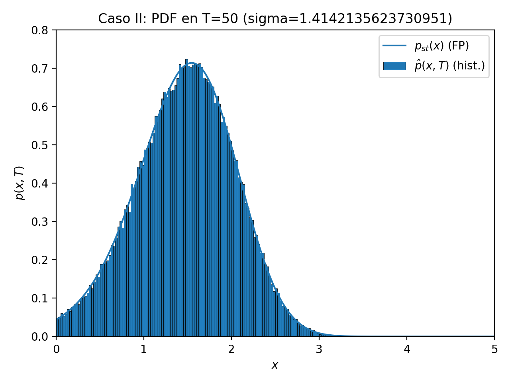
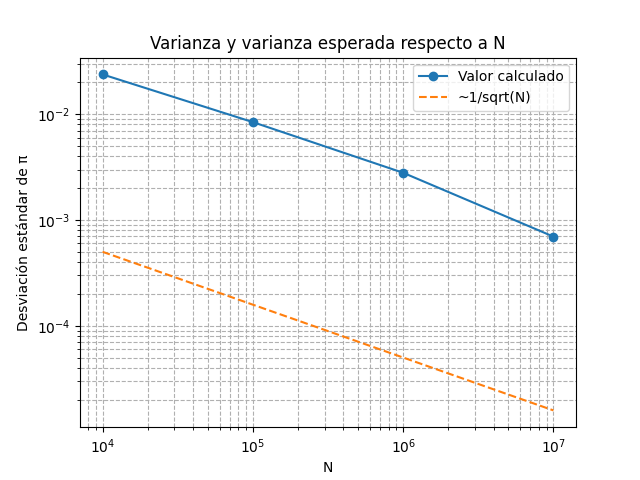
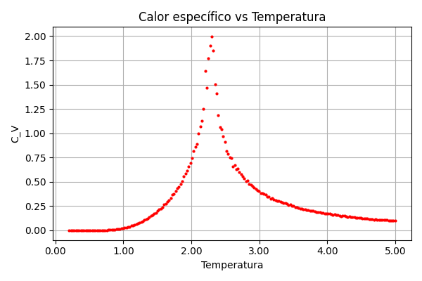

# Monte Carlo and stochastic simulation

Monte Carlo integration, importance sampling, Metropolis simulation of the 2D Ising model, and numerical integration of a stochastic differential equation checked against its Fokker–Planck stationary density. Written in Python (NumPy, Matplotlib), using a hand-written Park–Miller generator with Bays–Durham shuffle (`ran1`) as the random-number source. Course work for the M.Sc. in Advanced Physics (Computational Physics), UNED.


*Distribution of 100,000 trajectories of the SDE in part 04 at t = 50 (histogram), against the analytic stationary solution of the Fokker–Planck equation (line), for σ = √2.*

| Folder | Problem | Method | Check |
|---|---|---|---|
| [`01-monte-carlo-pi-random-generator`](01-monte-carlo-pi-random-generator) | Estimate π from the volume of the 4D unit hypersphere | Hit-or-miss Monte Carlo with `ran1` vs. Python's `random`; 50 repetitions per N | Standard deviation falls as 1/√N |
| [`02-importance-sampling`](02-importance-sampling) | ∫₀^0.8 cos(πx/2) dx | Uniform sampling vs. importance sampling with p(x) ∝ 1 − x², drawn by rejection; also a variant with a wrong envelope | Exact value 0.605461. With N = 2·10⁵: uniform 0.60523, importance sampling 0.60559, wrong envelope 0.61102 (biased) |
| [`03-ising-2d-metropolis`](03-ising-2d-metropolis) | 2D Ising model, periodic boundaries, T = 0.2–5 | Metropolis single-spin flips with equilibration sweeps | Energy, magnetisation, specific heat and susceptibility vs. T; the specific heat peaks near the Onsager value T_c ≈ 2.27 |
| [`04-stochastic-differential-equation`](04-stochastic-differential-equation) | dx = [a x − x² − b x/(1+x)] dt + σ x/(1+x) ∘ dW (Stratonovich), a = 2, b = 1 | Heun predictor–corrector, h = 10⁻³, 100,000 trajectories in batches, reflecting boundary at x = 0 | Mean, variance and the distribution at t = 50 against the analytic stationary density p_st(x) ∝ (1+x) x^(2/σ²−1) exp(4x/σ² − 2x³/(3σ²)) |


*Part 01: the standard deviation of the π estimate over 50 repetitions follows the expected 1/√N scaling.*


*Part 03: specific heat of a 40×40 Ising lattice starting from all spins up. The peak sits at the Onsager critical temperature T_c ≈ 2.27.*

## Usage

Run each part from inside its folder (`pip install -r requirements.txt`). Figures are written to `Outputs/` or the working directory.

```bash
# 01 – choose the mode at the top of main.py: "estimate_pi_value", "variance" (slow) or "plot_variance"
python main.py

# 02 – sampling histograms and estimates; error-vs-N plot
python main_debug.py
python plotter.py

# 03 – Ising model on an L×L lattice
python main.py --nfilas 20 --ncolum 20 --npasos 2000 --nequil 1000

# 04 – SDE: three noise intensities, mean/variance/PDF figures (100,000 paths; takes a while)
python main.py
```

Code comments and plot labels are in Spanish.
